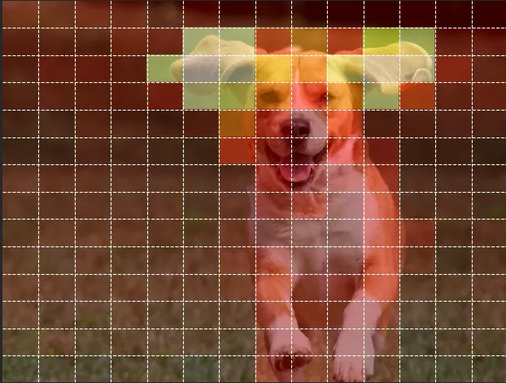

In my 7th semester, I got the chance to conduct a tutorial for the students of Machine Learning course as part of my UGTA-ship. It was a fun experience to learn about the wonderful new ViT that is DinoV3 and build demos to show its power. Here is a writeup for all that was discussed.

##  Vision Transformers

When we think of image related tasks, CNNs are a very natural architecture that come to mind (at least, traditionally so, nonwithstanding the image recognition capabilities of popular LLMs). In fact, CNNs are not necessary to deal with image patches and applying transformers directly to image patches can perform very well. 

An image is divided into fixed size non overlapping patches- we can think of these as our "words". The image patches are flattened and mapped to a d-dimensional vector with a trainable linear projection - these are our "tokens". Positional embeddings are also added and the resulting sequence is processed by a transformer. A [CLS] token prepended to the sequence is used to inform the classification head and image classification is performed in a manner analogous to text classification with the transformer.

<div style="text-align: center;">



</div>

Here the patch similarity is nothing but cosine similarity computed for the patch embeddings. Try it out!
<iframe
	src="https://neerjak-dinov3-patch-similarity-visualiser.hf.space"
	frameborder="0"
	width="750"
	height="650"
></iframe>

## DINO Applications and Advantages

DINO stands for Self-Distillation with NO labels. I'm going to leave that there because an explanation of self distillation and self supervised learning would make this way too long. 

What is interesting about DinoV3 for us is that it provides a solid "backbone" for smaller models to launch off of. It has been trained on 1.7B training images with 7B parameters due to its label-free training. Smaller models can use it's embeddings as an input and be finetuned for particular downstream tasks without much training cost. 

Model Architecture:
```python
backbone_name = 'vit_base_patch16_dinov3'
backbone = timm.create_model(
    backbone_name,
    pretrained=True,
    num_classes=0,
    global_pool='avg'
)
```

**Output**
```text
Eva(
  (patch_embed): PatchEmbed(
    (proj): Conv2d(3, 768, kernel_size=(16, 16), stride=(16, 16))
    (norm): Identity()
  )
  (pos_drop): Dropout(p=0.0, inplace=False)
  (rope): RotaryEmbeddingDinoV3()
  (norm_pre): Identity()
  (blocks): ModuleList(
    (0-11): 12 x EvaBlock(
      (norm1): LayerNorm((768,), eps=1e-05, elementwise_affine=True, bias=True)
      (attn): EvaAttention(
        (qkv): Linear(in_features=768, out_features=2304, bias=False)
        (q_norm): Identity()
        (k_norm): Identity()
        (attn_drop): Dropout(p=0.0, inplace=False)
        (norm): Identity()
        (proj): Linear(in_features=768, out_features=768, bias=True)
        (proj_drop): Dropout(p=0.0, inplace=False)
      )
      (drop_path1): Identity()
      (norm2): LayerNorm((768,), eps=1e-05, elementwise_affine=True, bias=True)
      (mlp): Mlp(
        (fc1): Linear(in_features=768, out_features=3072, bias=True)
        (act): GELU(approximate='none')
        (drop1): Dropout(p=0.0, inplace=False)
        (norm): Identity()
        (fc2): Linear(in_features=3072, out_features=768, bias=True)
        (drop2): Dropout(p=0.0, inplace=False)
      )
      (drop_path2): Identity()
    )
  )
  (norm): LayerNorm((768,), eps=1e-05, elementwise_affine=True, bias=True)
  (fc_norm): Identity()
  (head_drop): Dropout(p=0.0, inplace=False)
  (head): Identity()
)
```

In the above architecture, the image is split into non overlapping patches of size 16x16 and given positional embeddings with RoPE. Self attention is applied over the patch embeddings and then an MLP is applied to each patch. Attention will learn patterns across the image whereas the MLP will transform features within a token. Overall, this acts as a feature extractor that can be used for a variety of downstream tasks.

To make this perform as a classifier, we need add only a small head at the tail:
```python
class DinoClassifier(nn.Module):
  def __init__(self, backbone, num_classes=10):
    super().__init__()
    self.backbone = backbone
    feat_dim = backbone.num_features
    self.head = nn.Linear(feat_dim, num_classes)


  def forward(self, x):
    x = self.backbone(x)
    x = self.head(x)
    return x

model = DinoClassifier(backbone, num_classes=10)
```

Then we finetune this over our dataset which in this case is CIFAR-10 dataset. Since we are freezing the params in the backbone while keeping the head trainable this is called linear probing. 

```python
EPOCHS = 2
for epoch in range(EPOCHS):
  model.train()
  running_loss = 0.0
  progress_bar = tqdm(train_loader, desc=f"Epoch [{epoch+1}/{EPOCHS}]", leave=False, mininterval=3)
  for images, labels in progress_bar:
    images, labels = images.to(device), labels.to(device)
    optimizer.zero_grad()
    outputs = model(images)
    loss = criterion(outputs, labels)
    loss.backward()
    optimizer.step()
    running_loss += loss.item()
    progress_bar.set_postfix({'loss': f'{loss.item():.4f}'})
print(f"Epoch [{epoch+1}/{EPOCHS}] - Avg Loss: {running_loss/len(train_loader):.4f}")
```

The post finetuning accuracy is 97.4%. 

You can go through the [entire notebook here](https://colab.research.google.com/drive/1dkC308V7C5Q_yG6qKkYysnZz3XYUl2UI?usp=sharing).

One of the most interesting properties of DINO models is their emergent ability to capture object-level structure without explicit segmentation supervision. Through self-supervised training, DINO learns meaningful representations for the image patches, allowing patches with similar visual characteristics to cluster together in the latent space. As a result, coherent regions and boundaries can emerge and lead to powerful segmentation capabilities, as we observed in the patch similarity example.

Here is another demo that draws directly from the patch similarity demo, and shows a practical application of the model in a shopping app:

<iframe
	src="https://neerjak-dinov3-visual-fashion-search.hf.space"
	frameborder="5"
	width="800"
	height="950"
></iframe>

Credits to Prathmesh Shanbhag, my co-tutor for the above tutorial.

Some references that will go way more in depth than this blog:

1. A. Dosovitskiy et al., “An Image is Worth 16x16 Words: Transformers for Image Recognition at Scale,” arXiv.org, Oct. 22, 2020. Available online: [https://arxiv.org/abs/2010.11929](https://arxiv.org/abs/2010.11929)
2. M. Caron et al., “Emerging Properties in Self-Supervised Vision Transformers,” arXiv.org, Apr. 29, 2021. Available online: [https://arxiv.org/abs/2104.14294](https://arxiv.org/abs/2104.14294)
3. [https://vishal688.substack.com/p/dino-explained-how-self-supervised](https://vishal688.substack.com/p/dino-explained-how-self-supervised)
4. [https://ai.meta.com/research/publications/dinov3/](https://ai.meta.com/research/publications/dinov3/)